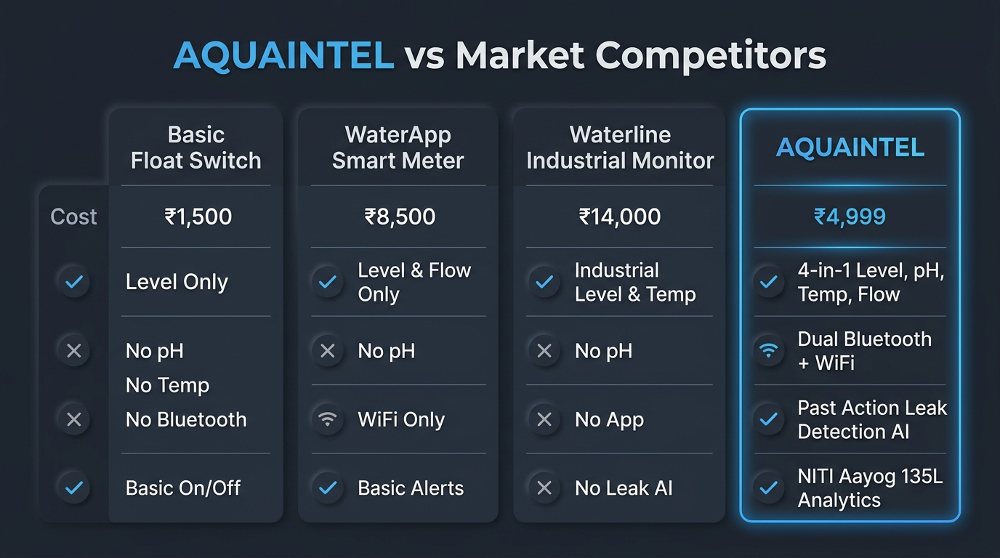
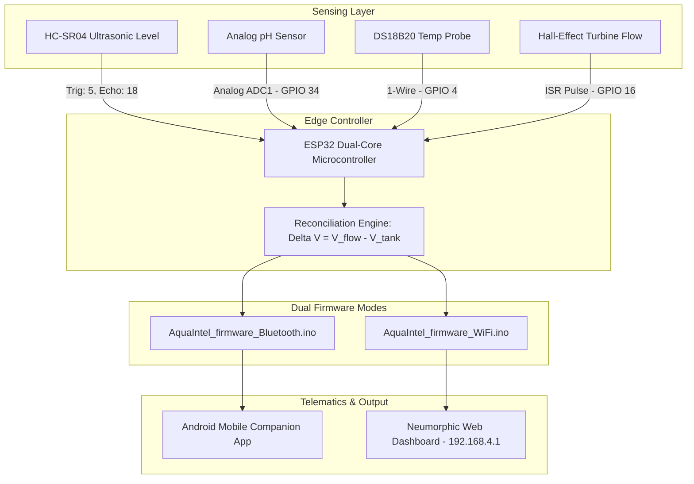

# 💧 AquaIntel: Four-Sensor Reconciled Water Tank Management System

[](https://www.espressif.com/)
[]()
[]()
[]()
[](LICENSE)

> **Developed by:** Mrityun Jay G & Tech-Vibrantz Team  

**AquaIntel** is an end-to-end, IoT-enabled autonomous water tank telemetry and water quality management system powered by the **ESP32**. 

Conventional tank monitoring reports only a single metric: how full the tank is. AquaIntel revolutionizes this through **Dual-Measurement Reconciliation**. Water entering the tank is measured twice via two independent physical principles: an inlet turbine flow sensor measuring inflow volume, and an ultrasonic depth sensor measuring actual tank volume rise. When the two diverge, the resulting **water-balance residual ($\Delta V$)** serves as a direct, quantified signal of leaks, unmetered draws, or overflow risks.

The project offers **two specialized firmware variants**:
1. 📱 **Bluetooth Serial Mode (`AquaIntel_firmware_Bluetooth.ino`):** High-speed, low-power telemetry streaming directly to the native Android companion mobile app (`AQUAINTEL.apk`).
2. 🌐 **Wi-Fi SoftAP Mode (`AquaIntel_firmware_WiFi.ino`):** Embedded web server serving a live neumorphic telemetry dashboard (`http://192.168.4.1`) for browser-based access without requiring any apps.

---

## 📸 System Overview & Comparative Performance

<div align="center">
  
  <br />
  <b>Figure 1: AquaIntel Technological Innovation & Capability Comparison Matrix</b>
</div>

---

## 📌 Key Engineering Innovations

### 1. Dual-Measurement Water Reconciliation
- Inflow is counted twice:
  $$V_{\text{flow}} = \int Q_{\text{turbine}}(t)\, dt \quad \text{vs.} \quad V_{\text{tank}} = \pi r^2 \cdot \Delta h$$
- **Leak & Overflow Residual:** When $\Delta V = V_{\text{flow}} - V_{\text{tank}} > \epsilon_{\text{threshold}}$, the system immediately flags pipe fractures, unmetered branch drawing, or overflow hazards before physical damage occurs.

### 2. Four-Sensor Complete Path Coverage
- **Ultrasonic Depth Sensing (HC-SR04):** Non-contact millimeter-accurate water level & capacity tracking (1,000 L cylindrical tank model).
- **Analog pH Electrode:** Continuous evaluation of water acidity/alkalinity ($0 - 14\text{ pH}$) to guarantee domestic potability.
- **DS18B20 1-Wire Digital Probe:** Waterproof temperature monitoring with $\pm 0.5^\circ\text{C}$ accuracy.
- **Interrupt-Driven Hall-Effect Sensor:** Hardware ISR counting instantaneous pulse frequencies ($7.5\text{ Hz} \equiv 1\text{ L/min}$) on `GPIO 16`.

### 3. Dual Firmware Architecture

| Feature | Bluetooth Variant (`AquaIntel_firmware_Bluetooth.ino`) | Wi-Fi Variant (`AquaIntel_firmware_WiFi.ino`) |
| :--- | :--- | :--- |
| **Primary Interface** | Native Android Companion App (`AQUAINTEL.apk`) | Browser Web Dashboard (`http://192.168.4.1`) |
| **Transport Layer** | Bluetooth Classic Serial (`AquaIntel_Companion`) | 2.4 GHz SoftAP (`SSID: AquaIntel_AP`) |
| **Data Protocol** | Formatted Delimited Packet Stream (`LVL,VOL,FLW...`) | HTTP JSON API Endpoint (`/data`) |
| **Power Profile** | Low Power Consumption | Continuous Web Server Availability |
| **Best For** | Mobile phone field monitoring & diagnostics | Multi-device cabin / desktop display |

### 4. Automated Multi-Threshold Safety Engine
- 🚨 **Pipeline Leak Alert:** Sustained non-zero inflow with stagnant tank depth.
- 🚨 **Overflow Risk:** Tank volume $> 95\%$ with active positive flow rate.
- 🚨 **Contamination Warning:** Ambient water pH moving outside potable limits ($6.5 < \text{pH} < 8.5$).

---

## 🏗️ System Architecture



---

## 🔌 Hardware Pinout Configuration

> 📖 For detailed level-shifting circuits and resistor values, see [PIN_CONFIGURATION.md](PIN_CONFIGURATION.md).

| Sensor / Module | Signal Line | ESP32 GPIO | Operating Voltage | Notes |
| :--- | :--- | :---: | :---: | :--- |
| **Ultrasonic Sensor (HC-SR04)** | `TRIG` | `GPIO 5` | 5V | 10µs trigger pulse |
| | `ECHO` | `GPIO 18` | 5V | Voltage divider to 3.3V |
| **Analog pH Sensor Module** | $P_o$ (Analog) | `GPIO 34` | 5V | ADC1 low-noise channel |
| **DS18B20 Digital Temp** | `DATA` | `GPIO 4` | 3.3V | 4.7kΩ pull-up to 3.3V |
| **Hall-Effect Flow Sensor** | Pulse Output | `GPIO 16` | 5V | Hardware interrupt pin |
| **Status Indicator** | LED Anode | `GPIO 2` | 3.3V | Diagnostic heartbeat |

---

## 💻 Getting Started & Flashing

### 1. Prerequisites & Libraries
Install the following libraries in Arduino IDE (`Ctrl+Shift+I`):
- `WiFi.h` & `WebServer.h` (Built-in ESP32 core)
- `BluetoothSerial.h` (Built-in ESP32 core)
- `OneWire` by Jim Studt, Paul Stoffregen
- `DallasTemperature` by Miles Burton

### 2. Flashing the Firmware

#### Option A: Flash the Bluetooth Version (For Mobile App)
1. Open `firmware/AquaIntel_firmware_Bluetooth.ino` in Arduino IDE.
2. Select **ESP32 Dev Module** under **Tools > Board**.
3. Upload to the board.
4. On your Android smartphone, pair via Bluetooth with **`AquaIntel_Companion`**.
5. Install and launch [`AQUAINTEL.apk`](AQUAINTEL.apk) to monitor live readings.

#### Option B: Flash the Wi-Fi Version (For Web Browser)
1. Open `firmware/AquaIntel_firmware_WiFi.ino` in Arduino IDE.
2. Select **ESP32 Dev Module** under **Tools > Board**.
3. Upload to the board.
4. Connect to the Wi-Fi network:
   - **SSID:** `AquaIntel_AP`
   - **Password:** `waterintelligence`
5. Open your browser and navigate to:
   ```text
   http://192.168.4.1
   ```

---

## 📱 Mobile Companion App
- The compiled Android application is available directly in the repository: [`AQUAINTEL.apk`](AQUAINTEL.apk).

---

## 🛡️ License
Distributed under the [MIT License](LICENSE).
